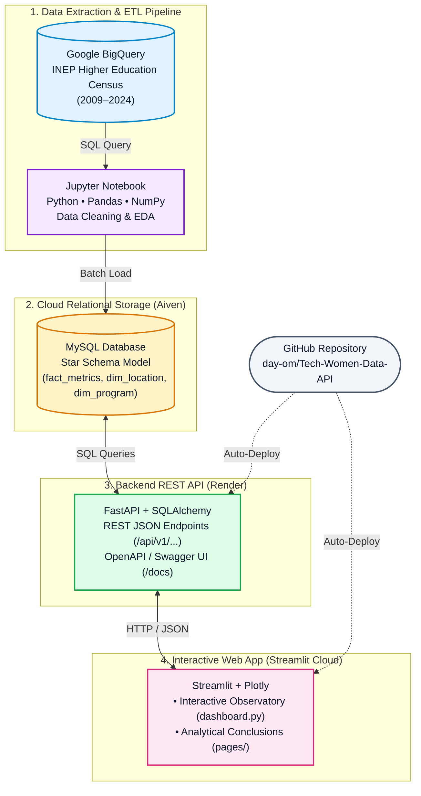

# 📊 Tech Women Data API — Women in Higher Education Tech

> **Data Analysis Pipeline, REST API & Interactive Dashboard** developed to map, analyze, and provide data on the representation, academic trajectory, and persistence of women in Information Technology higher education courses in Brazil over a 15-year period (2009–2024).

---

## 📌 About the Project

This project combines **Data Analysis**, **Backend Development (REST API)**, and **Interactive Data Visualization** to transform public microdata into accessible insights regarding gender equity in IT education.

The primary goal is to understand the evolution of female representation in Brazilian colleges and universities, identifying key bottlenecks such as dropout rates, regional disparities, and program-level participation affecting enrollment and graduation.

The core focus of this project is tracking **female representation** (entrants, active enrolled, and graduates) relative to the **overall student body count** across technology courses in Brazil.

---

## 🏗️ System Architecture

The solution follows an end-to-end cloud data architecture — from raw public microdata extraction and Star Schema modeling to a REST API and an interactive multi-page web dashboard:



---

## 📂 Data Source & Selection Strategy

- **Primary Source:** Microdata from the Higher Education Census (*Censo da Educação Superior*) conducted by **INEP** (National Institute for Educational Studies and Research Anísio Teixeira).
- **Access Repository:** Managed dataset extracted via [Base dos Dados — Higher Education Dataset](https://basedosdados.org/dataset/a3b57cca-ff80-4bf2-8bac-c145109e06a7?table=03f7e043-9ea1-47f9-9e77-f55dfe449381).
- **Timeframe:** 2009 to 2024 (15-year historical period).
- **Data Selection & Filtering:** Records were filtered by the general knowledge area corresponding to Information Technology:
  ```sql
  WHERE nome_area_geral = 'Computação e Tecnologias da Informação e Comunicação (TIC)'
  ```

The attributes cover three key stages of the higher education lifecycle: **Entrants (Ingressantes)**, **Active Enrolled Students (Matrículas)**, and **Graduates (Concluintes)**, tracking total female counts alongside general student body totals.

---

## 🛠️ Technologies & Demonstrated Skills

- **Data Processing & ETL:** Python (Pandas, NumPy) for large-scale data cleaning, filtering, and aggregation of public microdata.
- **Exploratory Data Visualization:** Matplotlib and Seaborn for generating statistical and temporal charts in notebooks.
- **Database & Data Modeling:** Google BigQuery for raw data extraction and MySQL (`pymysql`) structured as a **Star Schema** (`fact_metrics`, `dim_location`, `dim_program`) for analytical querying.
- **Backend & REST API:** Python, FastAPI, SQLAlchemy, Uvicorn, and `python-dotenv` for serving validated JSON endpoints with interactive OpenAPI/Swagger documentation.
- **Interactive Web Dashboard:** Streamlit and Plotly (`graph_objects`) for multi-page interactive visualizations, dynamic cross-filtering, and CSV data export.
- **Automated Testing:** Unit and integration test suite built with Pytest, `pytest-cov`, FastAPI `TestClient`, `unittest.mock`, and an in-memory SQLite Star Schema.
- **Cloud Infrastructure & Deployment:** Aiven (managed MySQL), Render (FastAPI backend hosting), Streamlit Community Cloud (frontend hosting), and Git/GitHub managed with Project Boards and Sprint-based organization.

---

## 📁 Project Structure

```text
project_data_API/
├── docs/
│   └── API.md                          # Full endpoint contracts, parameters, and JSON examples
├── notebooks/
│   └── Tech_Women_Data_API.ipynb       # BigQuery extraction, data cleaning, and EDA visualizations
├── pages/
│   └── 1_📊_Conclusoes_Analiticas.py   # Executive synthesis and analytical findings page
├── tests/
│   ├── __init__.py
│   ├── conftest.py                     # Mocked sessions & in-memory Star Schema fixtures
│   ├── test_unit_routes.py             # HTTP contract, query param validation & session lifecycle tests
│   └── test_integration_api.py         # End-to-end SQL analytical query validation
├── .env.example                        # Environment variables template for MySQL connection
├── .gitignore                          # Rules excluding .env, secrets.toml, venv, and test caches
├── dashboard.py                        # Main Streamlit interactive dashboard (Observatory)
├── database.py                         # SQLAlchemy engine & session management via environment variables
├── main.py                             # FastAPI application, query validations, and route definitions
├── queries.py                          # Analytical SQL queries (KPIs, rankings, dynamic filters)
└── requirements.txt                    # Project, API, dashboard, and testing dependencies
```

---

## 🖥️ Interactive Dashboard (Streamlit)

The project includes a multi-page **Streamlit + Plotly** web application consuming the REST API in real time:

- **Observatório Interativo (`dashboard.py`):** Historical period slider (2009–2024), funnel KPI cards, donut charts, interactive click-to-filter time series and state (`UF`) rankings, course rankings, and a dynamic API explorer with CSV export.
- **Conclusões Analíticas (`pages/1_📊_Conclusoes_Analiticas.py`):** Executive summary of the 15-year findings, regional/course highlights, and methodology overview.

- 🌐 **Live Dashboard:** [Access Streamlit App](https://tech-women-data-apii.streamlit.app/)
- ⚡ **Live API Docs (Swagger):** [Access Render API](https://tech-women-data-api.onrender.com/docs)

### ▶️ Running the Dashboard Locally

With the FastAPI server running on `http://127.0.0.1:8000`, open a second terminal and run:

```bash
python -m streamlit run dashboard.py
```

---

## 🚀 REST API & Automated Testing

### ▶️ Running the API Locally

1. **Create and activate a virtual environment, then install dependencies:**
   ```bash
   python -m venv venv
   source venv/bin/activate  # On Windows: venv\Scripts\activate
   pip install -r requirements.txt
   ```
2. **Configure environment variables:**
   Copy `.env.example` to `.env` and fill in your local MySQL credentials:
   ```bash
   cp .env.example .env
   ```
3. **Start the FastAPI server:**
   ```bash
   uvicorn main:app --reload
   ```
4. **Interactive Documentation:** Access `http://127.0.0.1:8000/docs` (Swagger UI) or `http://127.0.0.1:8000/redoc`.

### 📌 Endpoints Overview

| Method | Endpoint | Description |
| :--- | :--- | :--- |
| `GET` | `/` | Health check confirming API operational status |
| `GET` | `/api/v1/kpis/geral` | Consolidated historical KPIs (2009–2024) across all funnel stages |
| `GET` | `/api/v1/metricas/evolucao-temporal` | Year-over-year time series of totals and female percentages |
| `GET` | `/api/v1/metricas/estados` | State-level (`UF`) enrollment and graduation volume/share ranking |
| `GET` | `/api/v1/metricas/cursos` | Course-level ranking by female participation (`min_matriculas`, `limit`) |
| `GET` | `/api/v1/metricas/filtrar` | Dynamic multi-dimensional filtering by `ano`, `uf`, and `curso` |

> 📄 **Detailed Specification:** See [`docs/API.md`](docs/API.md) for complete query parameters, business rules, response schemas, JSON examples, and HTTP error codes.

### 🧪 Running the Test Suite

The project includes isolated **unit tests** (mocking database sessions and verifying `422` parameter bounds) and **integration tests** (executing real SQL queries against an in-memory Star Schema):

```bash
python -m pytest --cov=main --cov=database --cov=queries --cov-report=term-missing
```

---

## 📖 Data Dictionary

| Column | Meaning (EN) | Type |
| --- | --- | --- |
| **year** | Higher Education Census Reference Year | Int64 |
| **state_uf** | Federative Unit Abbreviation of Course Location | string |
| **course_name** | Course Name | string |
| **entrants_count** | Total Number of Entrants | Int64 |
| **entrants_female_count** | Number of Female Entrants | Int64 |
| **enrolled_count** | Total Number of Enrolled Students | Int64 |
| **enrolled_female_count** | Number of Female Enrolled Students | Int64 |
| **graduates_count** | Total Number of Graduates | Int64 |
| **graduates_female_count** | Number of Female Graduates | Int64 |

---

## 📊 Key Analytical Findings (2009–2024)

> 📓 **Full Code & Charts:** The complete SQL extraction from BigQuery, data cleaning pipeline, and Matplotlib/Seaborn visualizations are available in [`notebooks/Tech_Women_Data_API.ipynb`](notebooks/Tech_Women_Data_API.ipynb).

### 1. Entrants (Ingressantes)
- The percentage of female entrants began at **17.08% in 2009** and entered an almost constant decline, reaching an **all-time low in 2017 with only 13.43%**.
- Starting in 2018, a steady recovery began: `13.71% (2018)` → `16.58% (2020)` → `18.95% (2021)` → eventually surpassing the 20% mark.
- In **2024, the time series reached its historical peak** with **21.30%** female entrants (**104,176 female students** starting IT degrees that year).

### 2. Enrolled Students (Matrículas Ativas)
- **Cumulative Volume:** Over **6.4 million active enrollments** were recorded over the period, with **16.12% (1.03 million) representing women**.
- **Annual Trajectory:** The rate dropped continuously from `17.23% (2009)` down to a minimum of `13.16% (2018)`, recovering steadily from 2019 onward to reach **19.24% in 2024** (**153,931 active female students**, tripling absolute volumes compared to 2009).

### 3. Graduates (Concluintes)
- **Graduated Volume:** Brazil graduated **814,758 IT professionals** across the analyzed 15 years, with **132,057 being women (16.21%)**.
- **Academic Equilibrium:** The alignment of cumulative graduate rates (**16.21%**) with enrolled rates (**16.12%**) indicates that female students who stay in college maintain a proportionally strong graduation rate.
- **Historical Record:** In **2024, a record high of 19.16% female graduates** was registered (**19,253 newly qualified female professionals** in a single year).

### 4. Geographical Distribution (UF)
- **São Paulo (SP) as Dominant Hub:** Accounts for over **2.1 million enrollments** and **320,908 cumulative graduates**, maintaining a stable female representation rate of **17.4% to 17.6%**.
- **Leaders in Proportional Representation:** Excluding undeclared records, **Amazonas (AM)** leads with **18.4% enrolled** and **18.8% female graduates**, followed by **Pará (PA)** and **Alagoas (AL)**.
- **Inclusion Challenges:** States like **Paraná (13.89%)**, **Rio Grande do Sul (13.76%)**, and **Bahia (13.58%)** show lower female graduate percentages among major national hubs.

### 5. Course-Level Participation
- **Systems Analysis and Development (ADS):** Largest program by volume nationwide (**282,311 cumulative graduates**), with **14.5% female enrollments** and **16.83% female graduates**.
- **Pure Science & Engineering Majors:** Traditional Bachelor's degrees like **Computer Science (13.33% female graduates)** and **Computer Networks (8.00% female graduates)** face the largest attraction and retention hurdles.
- **Female Representation Catalysts:** Programs intersecting technology with **Business, Management, and Data Science** attract significantly higher shares of women:
  - **Business Informatics:** `> 26%` female participation.
  - **Data Science / Big Data:** `22% to 25%` enrolled female students.
  - **Internet Systems / IT Management:** `~19% to 20%` female graduates.

---

## 🏁 Summary of the Female Academic Journey (2009–2024)

| Stage of Journey | Historical Cumulative Average | Current Status (2024 - All-Time High) |
| --- | --- | --- |
| **Ingress (Entrants)** | **17.59%** | **21.30%** (104,176 new female entrants/year) |
| **Persistence (Active Enrolled)** | **16.12%** | **19.24%** (153,931 active female students) |
| **Completion (Graduates/Market)** | **16.21%** | **19.16%** (19,253 new female graduates/year) |

All three indicators display a distinct **"U-shaped" curve**: a systematic decline starting in 2009, hitting a critical bottom between 2017–2019 (~13%), followed by a **rapid recovery from 2020 onward** reaching historical peaks in 2024. The strong parity between active female students and graduation rates confirms the resilience and academic success of women in Brazilian higher technology education.